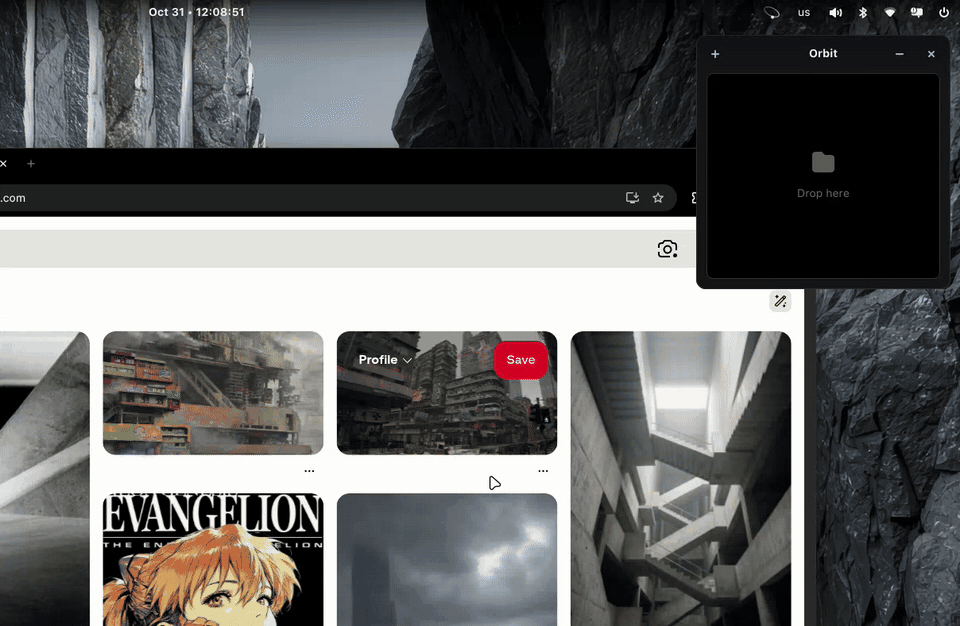

# Orbit

Native file shelf and panel applet for COSMIC.

Arch · Fedora · Ubuntu/Pop!_OS 22.04+ · x64/ARM64

```sh
curl -fsSL https://github.com/motixo/orbit/releases/latest/download/install.sh | sh
```

## Mouse

Double-click the header to switch between floating and pinned. Drag a pinned header toward a screen corner to move it there.

You can also drop files onto a collapsed pinned Orbit.

## Applet

In COSMIC Settings → Desktop → Panel or Dock → Applets, add **Orbit**. Drop files directly onto the applet to open an Orbit with them. Right-click it for Settings and Shortcuts.

## Watched folders

Right-click the applet or tray → Settings → Watch folder. New files added directly to the selected folder appear automatically in a separate Orbit.

## Sharing

Open **⋯ → Share** in an Orbit.

Complete **Initial file sharing** once. Reopen it from the applet or tray **Settings** to recheck AirDrop hardware.

**Orbit Share**

- Keep devices on the same network or hotspot. Nearby Orbits appear automatically; confirm the pairing code on both computers.
- On iPhone, Android or another computer, open the [web app](https://orbit.motixo-dev.workers.dev/) to scan the desktop QR (**Pair via QR**) or enter its link. PWA installation is optional.
- Share files, text and links both ways; folders become ZIP files. Keep the Share window open during transfers.
- Manage saved devices and permission to open Orbits from **Paired devices**.
- Downloads go to `Downloads/Orbit-Share`. Change the folder or PWA URL in **Settings**, or deploy your own [PWA](https://github.com/motixo/orbit-share-pwa). Changing the URL requires re-pairing.

[Croc](https://github.com/schollz/croc) encrypts files, WebRTC connects devices and syncs items, and mDNS discovers nearby computers. Files stay on your network; Cloudflare hosts the web app. Open it online once and wait for **Ready offline** to transfer without internet later.

**AirDrop**

Choose **Find devices** to send selected items, or **Receive** to accept files. Set the receiving Apple device to **Everyone for 10 Minutes**. [Owly](https://github.com/t4t5/owly) uses Apple's AWDL protocol and requires compatible Wi-Fi hardware. Wi-Fi disconnects during AirDrop and reconnects when you leave it.

**KDE Connect**

Install the optional service from **Initial file sharing**. It currently uses [Orbit's COSMIC KDE Connect fork](https://github.com/motixo/kdeconnect). Pair with KDE Connect on another device to send selected items or receive files into the shelf, with per-file progress.

## Shortcuts

Defaults inside an Orbit window:

| Shortcut | Action |
| --- | --- |
| Ctrl+N | New Orbit |
| Ctrl+P | Pin / Unpin |
| Ctrl+Shift+P | Next corner (pinned) |
| Ctrl+M | Collapse / Expand (pinned) |
| Ctrl+O | Add files |
| Ctrl+Shift+O | Add folders |
| Ctrl+C | Copy selected items |
| Ctrl+V | Add from clipboard |
| Ctrl+A | Select all |
| Delete | Remove selected items, or all if none selected |
| Ctrl+Q | Close Orbit |
| Ctrl+Z | Undo removal |
| Space | Preview |

Use **Shortcuts** to customize these and assign desktop shortcuts for **New Orbit** and **Orbit Menu**.


